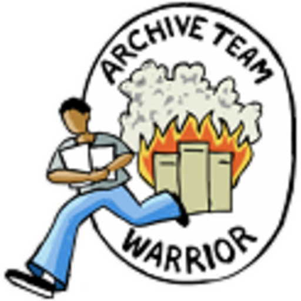
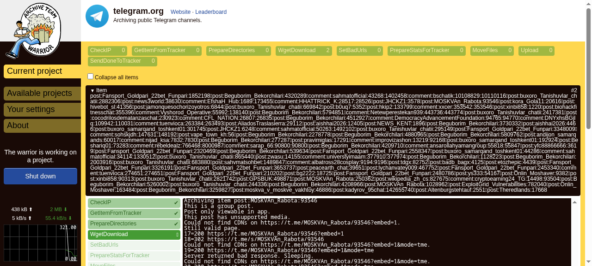

<h1>
  
  ArchiveTeam Warrior pour YunoHost
</h1>

Le Warrior d'ArchiveTeam est un outil bénévole qui télécharge automatiquement des données de sites web avant leur disparition, et les envoie vers Archive.org. Ce paquet exécute l'image Docker officielle du Warrior, orchestrée par YunoHost (compose + systemd).

**Version livrée :** voir manifest.toml

## Caractéristiques

- Image Docker officielle archiveteam/warrior-dockerimage
- Tableau de bord web accessible via le portail YunoHost
- Pseudo de classement dérivé du compte administrateur YunoHost
- Données WARC persistantes dans le répertoire de données de l'app

## Liens

- Projet amont : <https://github.com/ArchiveTeam/warrior-dockerimage>
- Paquet YunoHost : <https://github.com/quartztester/archiveteam-warrior_ynh>

## Screenshots

